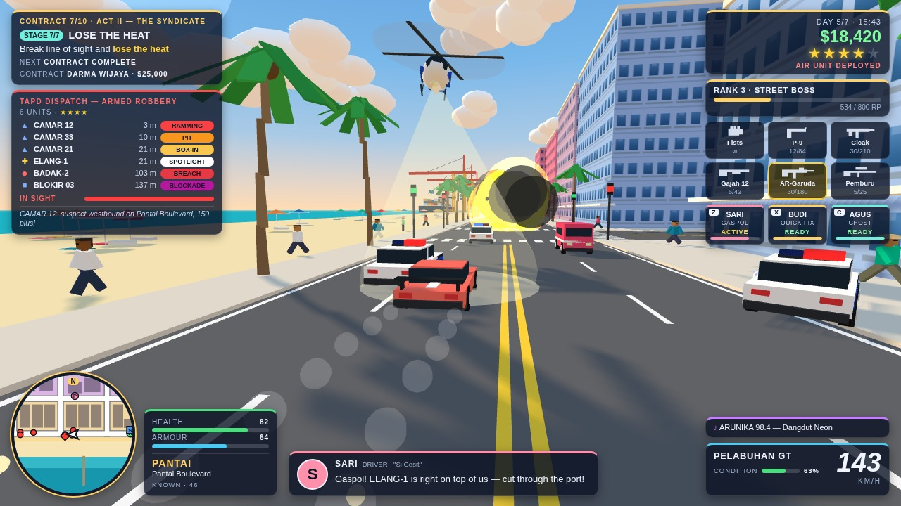
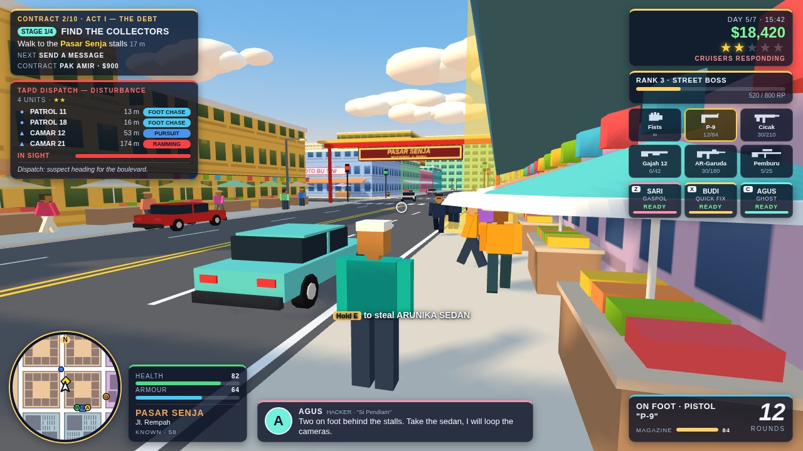
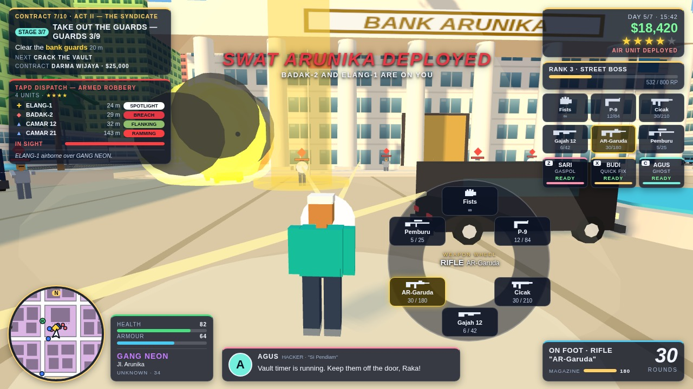
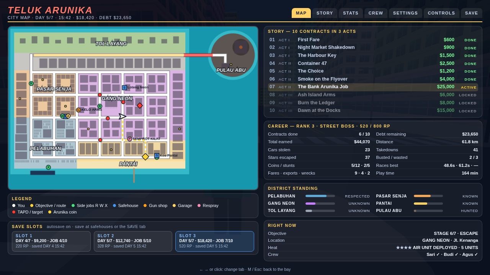

# TELUK ARUNIKA: Seven Days of Debt

[](https://make.fun/bounty/gta6-01) [](https://make.fun/bounty/gta6-01) [](https://make.fun/bounty/gta6-01)

A sun-soaked, fully 3D open-world crime game that runs from one static web page. Raka, a dock courier in the
Indonesian port city of Teluk Arunika, owes the syndicate boss Darma Wijaya $50,000 and has seven in-game days
to clear it: ten staged contracts in three acts, a bank heist, a police force that hunts in named units with
roles, a helicopter with a searchlight, a SWAT van, a crew with abilities, street races, a full map and saves.

Everything is original and made in code: every building, car, person, texture, icon and sound. The only
third-party file is the three.js r160 library in `game/vendor/`.



| | |
|---|---|
|  |  |



## What is in the game

### 1. Open world and atmosphere
- One seamless city of six districts, each with its own look: **Pelabuhan** (container port, cranes, a moored
  ship), **Pasar Senja** (shophouses and a street market under two gates), **Gang Neon** (pastel towers and
  Bank Arunika), **Pantai** (hotels, palms, beach umbrellas, a pier), **Tol Layang** (an elevated highway and
  bridge) and **Pulau Abu** (an ash island with a smoking volcano).
- A day and night clock (one real second is one game minute), a moving sun, clouds, gulls, and tropical rain
  with slick roads (press V).
- Left-hand traffic with nine vehicle types that stop at working traffic lights, and pedestrians who walk the
  pavements, flee from gunfire and dive away from cars.
- A chase camera for driving and an over-the-shoulder camera on foot, both collision-aware.

### 2. Missions and story
- Ten contracts in three acts, each with two to seven named stages, an intro card with dialogue, a timer or a
  progress bar where it fits, and a payout that goes partly toward the debt.
- Contract 5 is a real choice (pay Darma or sell him out) and Contract 10 has three endings.
- Contract 7 is a seven-stage bank job: reach the bank, cut the alarm, clear nine guards, crack the vault,
  grab the cash, escape to the boulevard, lose a four-star response.
- If day seven ends with the debt unpaid, Darma takes everything Raka has and the clock is wound back.

### 3. Police, combat and chases
- A five-star wanted system. TAPD responds in named units with live roles on a dispatch card: foot patrols,
  **CAMAR** cruisers (pursuit, ramming, PIT, flanking, box-in), **BLOKIR** roadblocks with spike strips, the
  **ELANG-1** helicopter with a searchlight, and the **BADAK** SWAT van that deploys a breach team and a sniper.
- Line of sight matters: break it and the heat bar drains; a respray shop or the hacker's Ghost ability helps.
- Six weapons (fists, pistol, SMG, shotgun, rifle, sniper) with magazines and reloads, a weapon wheel that
  slows time, enemies that take cover, health bars on targets, explosions that chain between cars.
- Cars have damage, smoke, flat tyres, fire and wrecks; every car on the street can be stolen.

### 4. Side activities and progression
- Three street races with rivals and best times, taxi fares, car export at the dock, wreck contracts against
  named drivers, twelve Arunika coins and five stunt ramps.
- A gun shop, a garage with engine and plating upgrades, a respray shop and three safehouses that save.
- A crew of three with abilities on cooldown: Sari (Gaspol speed burst), Budi (Quick Fix) and Agus (Ghost).
- Five ranks with perks, earned with rank points; standing in each district; a statistics page.
- Three radio stations synthesised live, plus engine, siren, gunfire and crash sounds.

### 5. Interface and polish
- A full HUD: mission card, dispatch card, round minimap with a route, health and armour, location banner,
  clock, money, stars, rank bar, weapon slots, crew cards, radio line, car card with speed, crew chatter.
- A tabbed map screen (map, story, stats, crew, settings, controls, save) that doubles as the pause menu.
- A title screen, three manual save slots and an autosave, all in the browser's local storage.

## Controls

| Key | Action |
|---|---|
| W A S D | Walk / drive |
| Mouse | Look and aim (click the game to capture the mouse) |
| Left click / right click | Fire or punch / aim |
| Shift | Sprint |
| Space | Jump on foot, handbrake in a car |
| E | Enter a car (hold to steal) or get out |
| F | Interact: contracts, side jobs, shops, safehouses |
| Tab | Weapon wheel |
| 1 to 6 | Select a weapon, or buy in a shop |
| R | Reload |
| Z, X, C | Crew abilities: Gaspol, Quick Fix, Ghost |
| Q | Next radio station |
| H | Horn |
| V | Toggle rain |
| M | Map screen |
| P or Esc | Pause |

## How to run

```
node serve.ts
```

Then open `localhost:8080` in a desktop browser. No build step, no install, no network access.

The entry program copies the game and the screenshots to the output directory and writes the dossier:

```
MAKEFUN_OUTPUT_DIR=/tmp/out node main.ts
```

## How the screenshots are made

The four images in `screenshots/` are real frames of the game. `tools/shoot.mjs` serves `game/` locally, opens
each showcase scene listed in `shots.json` (`?scene=1` to `?scene=4`, with a fixed seed) in headless Chromium
at 1280x720, waits for the scene to signal it is ready, and saves a JPEG under the size cap. A showcase scene
stages real game entities with the real systems, runs a fixed number of real simulation steps and freezes; it
draws nothing by hand. `tools/selftest.mjs` checks the files and then plays the game in headless Chromium
(new game, driving, wanted level, a contract stage, shooting, saving, the map screen, all four scenes).
Both tools need `playwright-core` and a Chromium build from outside this repository; see the top of each file.

## File map

| Path | What it holds |
|---|---|
| `main.ts` | Entry program: copies `game/` and `screenshots/`, writes `dossier.json` |
| `serve.ts` | Static server for local play |
| `shots.json` | The four screenshots and the query that reproduces each |
| `game/index.html`, `game/style.css` | The page and all HUD and menu styling |
| `game/js/game-config.js`, `game-state.js` | Tuning data, places, weapons, crew, ranks; saved state and slots |
| `game/js/input-controls.js`, `render-scene.js` | Keyboard and mouse; renderer, lights, sky, cameras |
| `game/js/mesh-factory.js`, `city-builder.js` | Cars, people, props built from boxes; the city and its collision map |
| `game/js/traffic-ai.js`, `pedestrian-ai.js` | Traffic and traffic lights; pedestrians |
| `game/js/player-onfoot.js`, `vehicle-driving.js`, `weapons-combat.js` | Raka on foot; car physics and damage; guns and enemy AI |
| `game/js/police-wanted.js`, `police-airswat.js` | Wanted level, units and roles; helicopter and SWAT |
| `game/js/story-missions.js`, `side-activities.js` | The ten contracts; races, fares, export, wrecks, coins, ramps, shops |
| `game/js/crew-abilities.js`, `career-progress.js` | Crew and abilities; ranks, standing, statistics |
| `game/js/audio-radio.js`, `visual-effects.js` | Synthesised sound and radio; particles, markers, rain |
| `game/js/hud-panels.js`, `hud-minimap.js`, `menu-screens.js` | HUD cards; minimap and city map; title, map and pause screens |
| `game/js/showcase-scenes.js`, `game-main.js` | The four screenshot scenes; boot and the fixed-step loop |
| `tools/shoot.mjs`, `tools/selftest.mjs` | Screenshot tool and self-test |

## Originality

Teluk Arunika, its districts, characters, vehicles, police force and story are invented for this entry. Nothing
is taken from any existing game: no names, maps, models, textures, audio or code.

## License

MIT. See `LICENSE`.
