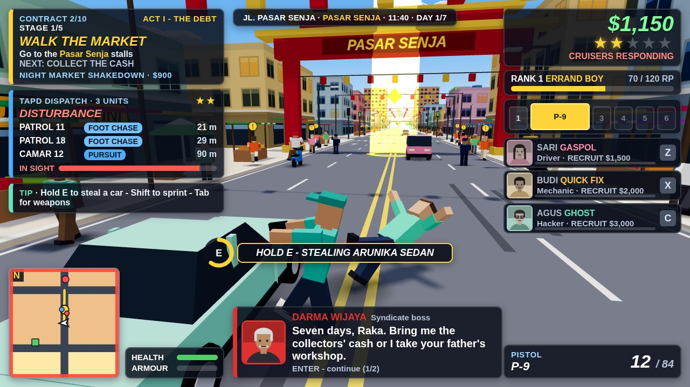
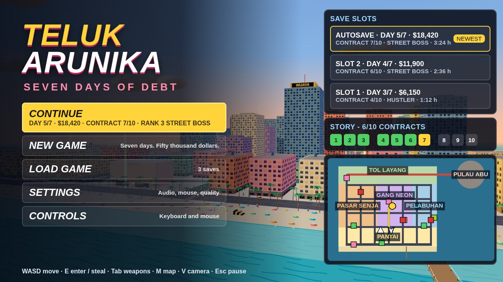

# TELUK ARUNIKA: Seven Days of Debt

[](https://make.fun/bounty/gta6-01) [](https://make.fun/bounty/gta6-01) [](https://make.fun/bounty/gta6-01)

A sun-soaked 3D open-world crime game set in a fictional Indonesian port city. Raka drives a taxi; his father
signed a fifty-thousand-dollar debt to the syndicate boss Darma Wijaya, and the workshop goes in seven days.
Ten staged contracts in three acts lead from a first taxi fare to the Bank Arunika job, with the Teluk Arunika
Police Department (TAPD) escalating from foot patrols to roadblocks, the ELANG-1 helicopter and a SWAT team.

Everything is drawn and synthesised by the game's own code at run time: there are no image, model or audio
files. The only third-party file is Three.js r160 (`game/vendor/three.min.js`).


| | |
|---|---|
|  |  |



## What is in the game

### Open world

- One continuous city on a bay with six districts: Pelabuhan (container port), Pasar Senja (market and
  shophouses), Gang Neon (downtown towers), Pantai (beach boulevard and pier), Tol Layang (flyover and bridge)
  and Pulau Abu (volcanic island).
- Named streets, landmarks (Bank Arunika, Wijaya Tower, the Pasar Senja gate, the pier, the container yard),
  three safehouses, a gun shop, a respray shop and an export dock.
- Ambient traffic on left-hand lanes with traffic lights, six civilian vehicle types (sedan, GT, taxi,
  minibus, scooter, hauler), and pedestrians who walk, cross, panic and dive out of the way.
- A day clock with changing light, an optional rain mode, three synthesised radio stations and a corner
  minimap plus a full-screen city map with route lines.

### Crime and police

- Carjacking: hold E at an occupied car to drag the driver out behind a progress ring; tap E for parked cars.
- Five wanted stars with heat and line of sight. The TAPD dispatch card lists every unit by call sign with
  its role (ramming, PIT, box-in, flanking) and distance.
- Roadblocks with barriers and spike strips at three stars; at four, the ELANG-1 helicopter with a
  searchlight and the BADAK-2 van with the SWAT ARUNIKA team; at five the team brings a sniper.
- Escape by breaking line of sight, respraying the car, or with a crew ability.

### Story and missions

- Ten contracts in three acts (The Debt, The Syndicate, Dawn), each a chain of staged objectives: go to,
  collect, steal a vehicle, hold a position, eliminate, destroy a convoy, lose the heat.
- Contract 7, The Bank Arunika Job, runs seven stages: reach the bank, cut the alarm, take out the guards,
  crack the vault, grab the cash, escape to Pantai Boulevard and lose the heat.
- A mid-story choice (pay Darma or meet the detective) changes the later contracts and the ending.
- Dialogue with drawn portraits, mission intro cards and crew radio chatter.

### Combat and driving

- Six weapons on a weapon wheel: fists, P-9 pistol, Cicak SMG, Gajah 12 shotgun, AR-Garuda rifle and
  Pemburu sniper, with aiming, reloads, tracers, hit markers and damage numbers.
- Guards and rivals that take cover, fire in bursts and advance.
- Arcade car physics with handbrake drifts, collisions, damage, explosions and three driving cameras
  (chase, hood, cinematic look-back).

### Progression and extras

- A three-person crew to recruit, each with a cooldown ability: Sari (speed burst), Budi (repair) and
  Agus (drops a wanted star).
- Five ranks from Errand Boy to King of the Bay with perks, district standing, money and the debt clock.
- Side jobs: three street races, taxi fares, wreck contracts, hidden Arunika coins, stunt ramps, car export
  and upgrades.
- An autosave plus three manual save slots, settings, contextual tutorial hints and a title screen that
  shows the newest save.

## Controls

| Key | Action |
|---|---|
| W A S D / arrows | Move, drive |
| Mouse | Look, aim |
| Left / right mouse button | Fire / aim |
| Mouse wheel | Pull the on-foot camera back or in |
| Shift | Sprint |
| Space | Jump on foot, handbrake in a car |
| Ctrl | Crouch |
| E | Enter, exit, steal a car (hold), interact |
| Tab, 1-6, R | Weapon wheel, pick a weapon, reload |
| Z / X / C | Crew abilities: Sari, Budi, Agus |
| V, [ and ] | Change camera, turn the camera |
| Q / H | Radio station / horn |
| M / Esc | City map / pause |
| F5 | Quick save |
| T / G / U / B | Taxi fares / recruit / upgrades / buy ammo (at the matching place) |
| P | Toggle rain |

## How to run

The game is a static page. With Node 22 or newer:

```
node serve.ts
```

then open `http://localhost:8080`. Any other static file server pointed at `game/` works as well.

`node main.ts` is the bounty entry program: it copies `game/` and `screenshots/` into the output directory
(`MAKEFUN_OUTPUT_DIR`, default `/output`) and writes `dossier.json` there.

## How the screenshots are made

The four images in `screenshots/` are real renders of the game. `tools/shoot.mjs` serves `game/`, opens the
page in headless Chromium at 1280x720 with the queries listed in `shots.json` (`?shot=1` to `?shot=4`), waits
for the scene-ready flag and saves a JPEG under the byte cap. Each query stages a scene from the game's own
entities and systems (`game/js/showcase-scenes.js`), runs a few real simulation steps and freezes the frame.
`tools/selftest.mjs` checks the repository and plays through the basics (new game, driving, wanted level,
mission stage, save and load) in the same browser. Both tools need `playwright-core`, which is not part of
this repository; set `PLAYWRIGHT_CORE` to its folder and `CHROMIUM_PATH` to a Chromium binary.

## File map

| Path | What it holds |
|---|---|
| `main.ts` | Bounty entry program (copy game and screenshots, write the dossier) |
| `serve.ts` | Small local static server |
| `shots.json` | The four screenshot scenes |
| `tools/shoot.mjs`, `tools/selftest.mjs` | Screenshot capture and self-test |
| `game/index.html`, `game/style.css` | Page, canvas and HUD styles |
| `game/js/open-world-city.js` | Roads, districts, landmarks, sea, collision map, lane graph |
| `game/js/traffic-ai.js`, `pedestrian-ai.js` | Ambient traffic and pedestrians |
| `game/js/player-onfoot.js`, `car-theft.js`, `vehicle-driving.js` | Raka on foot, carjacking, car physics |
| `game/js/police-wanted.js`, `police-roadblocks.js`, `police-airswat.js` | Wanted level and dispatch, roadblocks, helicopter and SWAT |
| `game/js/story-missions.js`, `story-dialogue.js` | The ten contracts, dialogue and chatter |
| `game/js/weapons-combat.js` | Weapons, weapon wheel, enemies |
| `game/js/side-activities.js`, `crew-abilities.js`, `career-progress.js` | Side jobs and shops, crew, rank and debt clock |
| `game/js/save-slots.js` | Save slots and settings |
| `game/js/hud-panels.js`, `hud-minimap.js`, `menu-screens.js`, `tutorial-hints.js` | HUD cards, minimap and city map, menus, hints |
| `game/js/render-scene.js`, `camera-rigs.js`, `mesh-factory.js`, `visual-effects.js` | Renderer and sky, cameras, procedural meshes, effects |
| `game/js/audio-radio.js`, `input-controls.js` | Synthesised audio and radio, keyboard and mouse |
| `game/js/game-config.js`, `game-state.js` | Data tables, game state and helpers |
| `game/js/showcase-scenes.js`, `game-main.js` | Screenshot scenes, boot and the fixed-step loop |
| `game/vendor/three.min.js` | Three.js r160 (MIT) |
| `vendor/makefun-game.ts` | make.fun kit helper used by `main.ts` |

## Originality

Teluk Arunika is an original setting. The city, its districts, characters, vehicles, police units, brands and
story are invented for this game, and no names, art, audio or code come from any existing game.

## License

MIT, see [LICENSE](LICENSE).
